This fall I have been thinking a lot about local solutions that people have come up with across the
world for their problems. There are some pursuits that are universal to the act of living in a society 
("How do I grow my food?", "How do I construct my shelter?", "How do I clothe myself?") and
it is incredible to observe the range of ingenuity with which communities across the world have addressed 
these issues ("Terrace farming", "igloos", "loincloth"). These indigenous solutions "make sense" for each 
individual community with respect to their ecology, climate, culture and know-how, although for quite some time 
now our world has been hurling towards homogeneous solutions that may be ill-suited for some. E.F Schumacher calls 
these "sensible" solutions "appropriate technology" in his deservedly well-lauded book _Small is Beautiful_. [^1]

Defined as such, these appropriate solutions are usually much more sustainable and often times can be more elegant
than the modern day solution, often fueled as the latter is by the formidable industrial forces of mass reproducibility, 
economy and efficiency, leading them to run over their predecessors/competitors in the Darwinian environment of technique. 
While critiques can be nuanced from technique to technique, at the very least, these displaced solutions are effective 
approaches that remind us of an alternate conception of the world than the current mainstream. 

--- 
With thoughts like these swirling in my mind, it so happened that my curiosity got piqued by the now uncommon door-locking 
mechanisms I saw in my most recent visit to Nepal. The rest of this post is a tour of some of the locking techniques I found. 

It started with when I purchased this incredibly cool lock and key:

<figure style="margin: 20px 0;">
  

    
    

      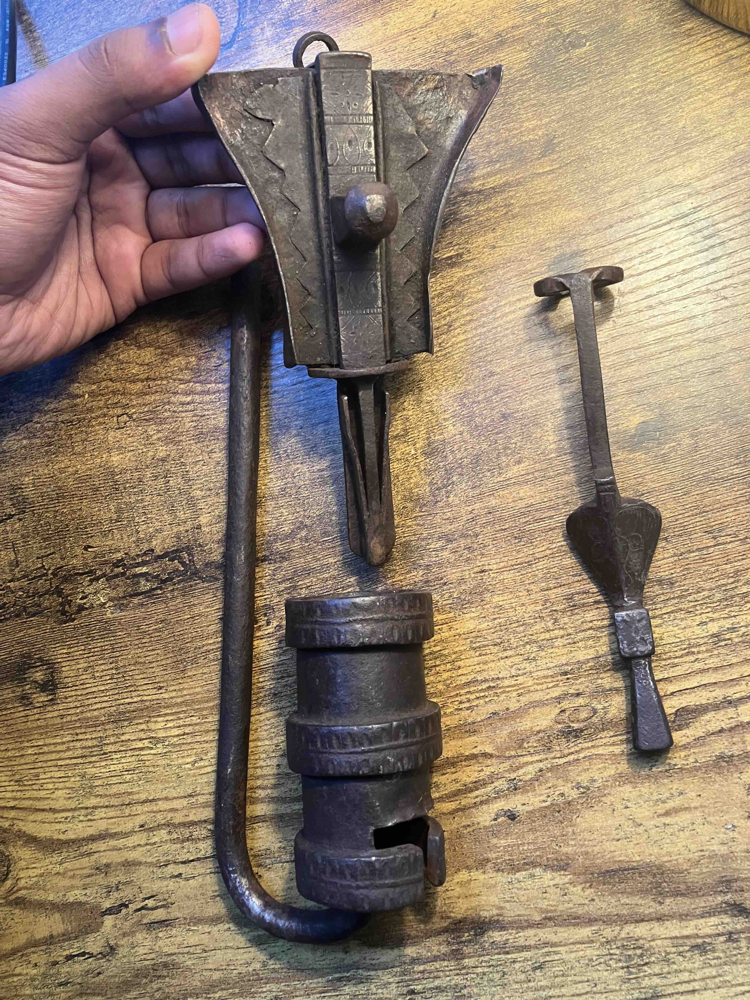
      (1.a)
    

    

      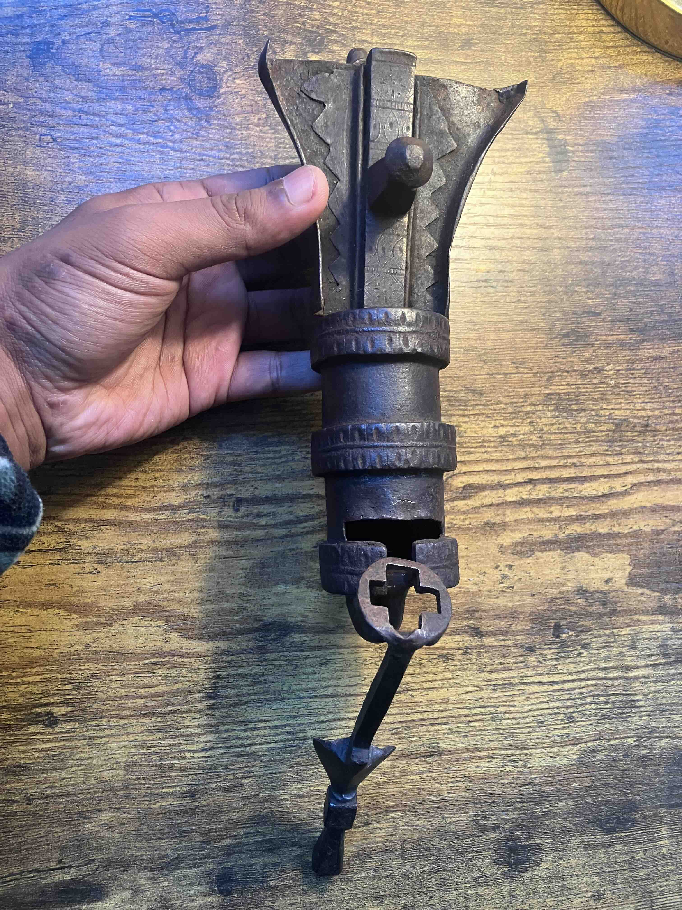
      (1.b)
    

    

      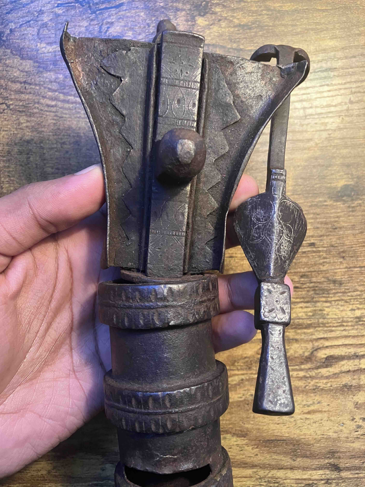
      (1.c)
    

  

  
  <figcaption style="text-align: center; font-style: italic; margin-top: 10px; color: #444;">
    Figure 1: The lock and key I purchased from street vendors near Patan.
  </figcaption>
</figure>

(1.a) shows the lock and key apparatus fully deconstructed. The key is the stalk-like object on the right. The way to lock it is to push the V-shaped object into a hole (not pictured) in the top of the barrel-shaped object, as shown in (1.b) where the apparatus is fully locked. Notice the tweezer shaped device at the bottom of the V-shaped object in (1.a). The top hole in the barrel is just big enough to let the tweezer through, but it pinches the tweezer on its way in. When the tweezer is fully inside the barrel, it bounces back out to its usual state, making it too wide to come out of the barrel hole. This is how the apparatus locks. The way to open it is to put the key into the bottom hole in the barrel (where the key is leaning against in (1.b)) and push up towards the tweezer, pinching it again, so that it can now leave through the top hole of the barrel. 

(1.c) is a close up, where you can see how pretty the engravings are. 

This lock and key I bought is of unknown provenance. It is possible that it belonged to a temple, but more probable is that it came from a regular household, where I understand these locks were commonly used to lock both doors and chests. 

Here are some pictures of these locks in action, all on doors in temples around Kathmandu/Patan. You will also find such locks on the temples of Bhaktapur. 

<figure style="margin: 20px 0;">
  

    
    

      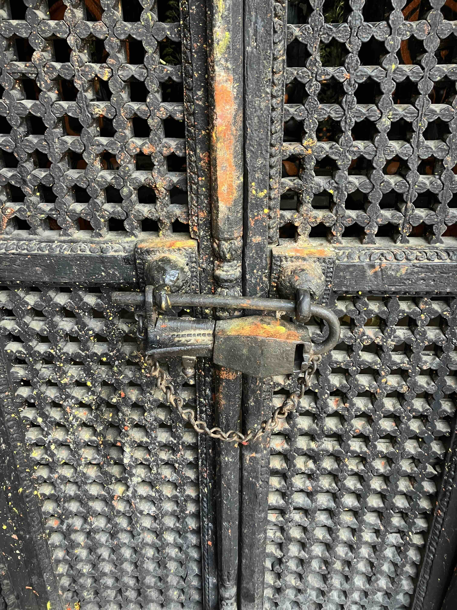
      (2.a)
    

    

      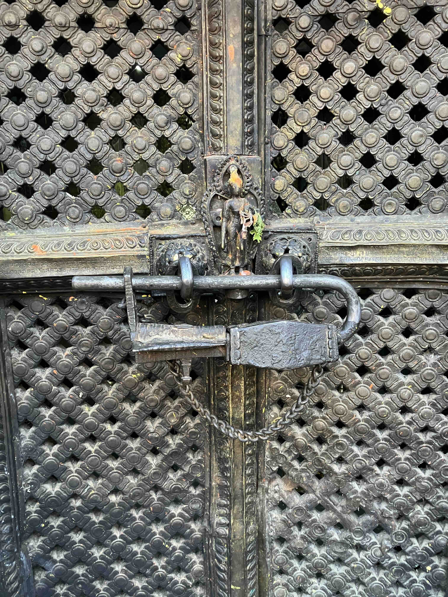
      (2.b)
    

    

      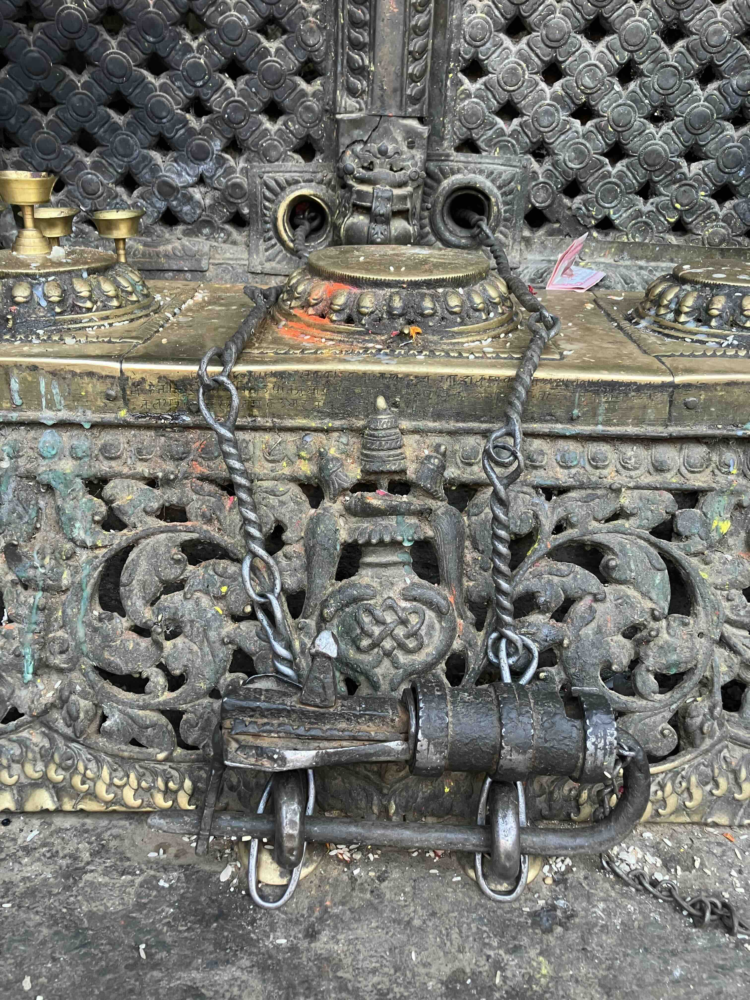
      (2.c)
    

  

  
  <figcaption style="text-align: center; font-style: italic; margin-top: 10px; color: #444;">
    Figure 2: The locks still in use around Patan/Kathmandu.
  </figcaption>
</figure>

(2.c) is particularly interesting because the ring latch is not mounted onto the door like the other two. Instead, the ring latch is on the floor and two strands of coiled metal that are tied to the door reach out to the ring and the lock binds the coiled strands to the grounded ring latch instead. 

---
This "coiled metal strand" style is also quite commonly found around town if you keep your eyes open for them:

<figure style="margin: 20px 0;">
  

    
    

      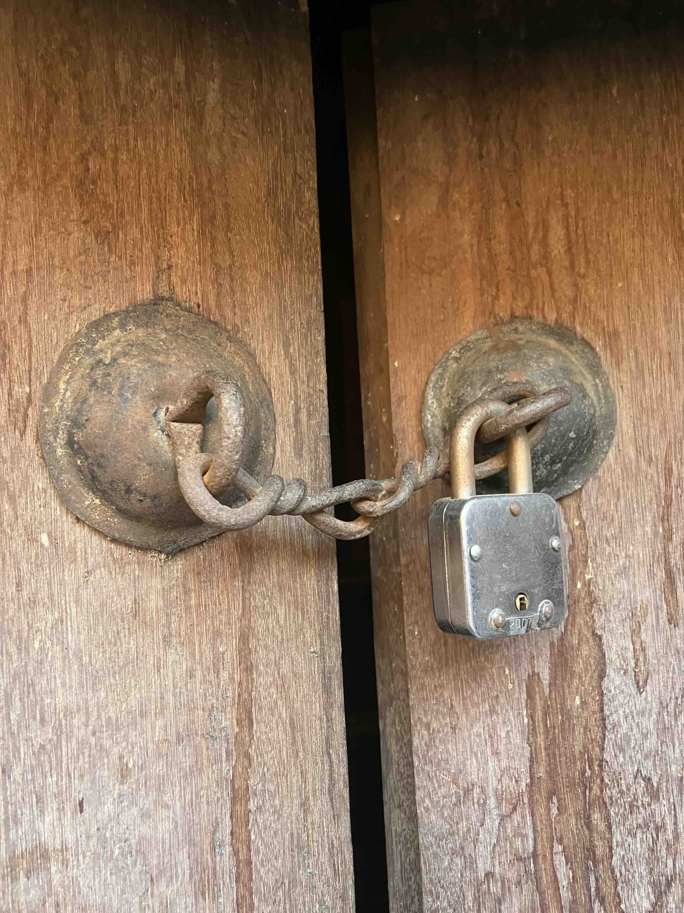
      (3.a)
    

    

      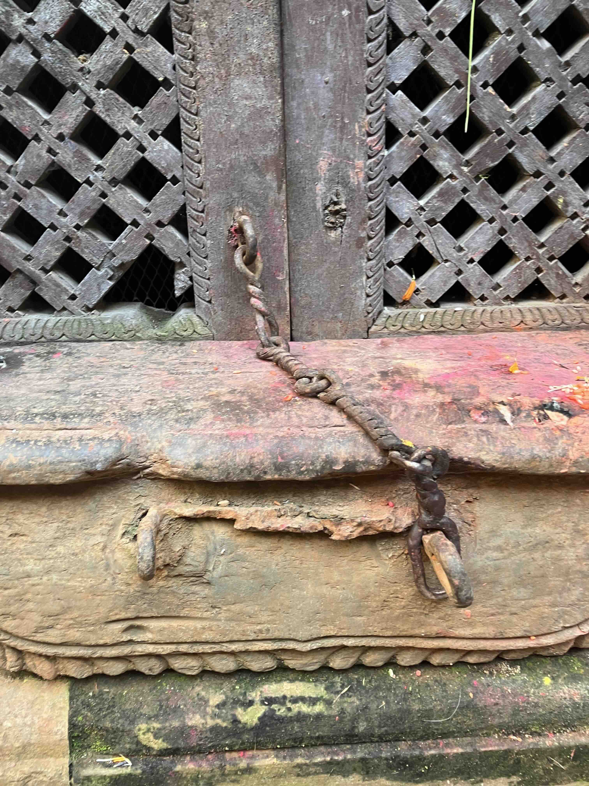
      (3.b)
    

    

      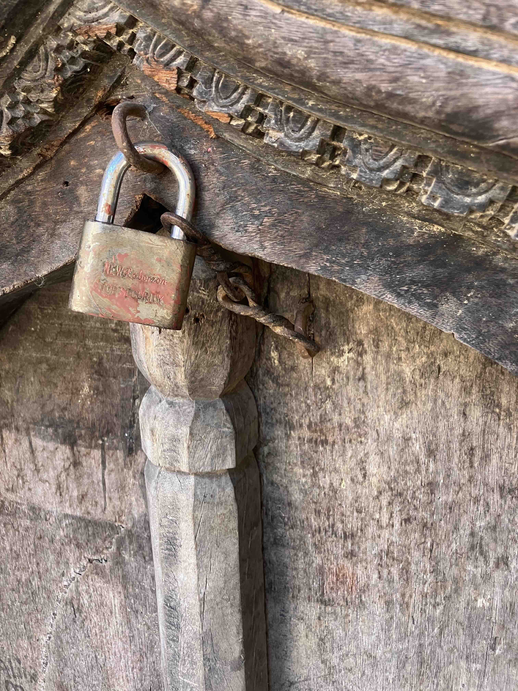
      (3.c)
    

    

      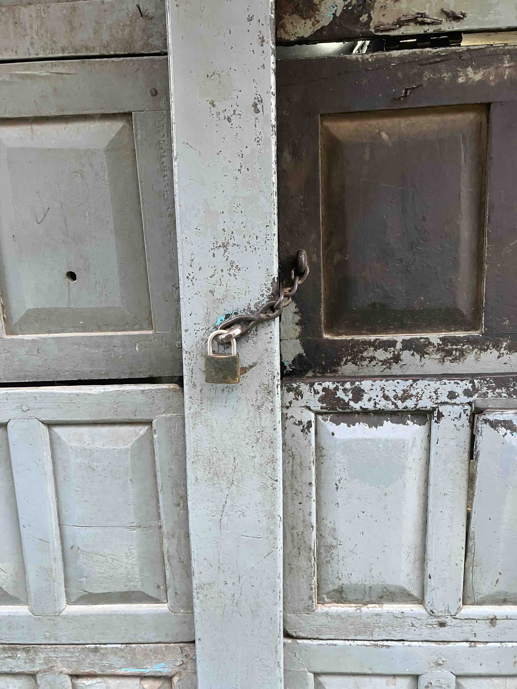
      (3.d)
    

  

  
  <figcaption style="text-align: center; font-style: italic; margin-top: 10px; color: #444;">
    Figure 3: Keeping the door locked with a coiled metal strand (not quite a chain).
  </figcaption>
</figure>

I wonder if they always were meant to be used with a padlock as shown, or if there was another kind of lock they
used here. 

---
Our next one is a similar idea, where the binding object sort of looks like an arrow:

<figure style="margin: 20px 0;">
  

    
    

      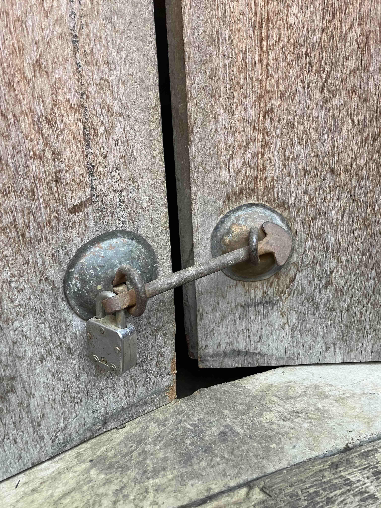
      (4.a)
    

    

      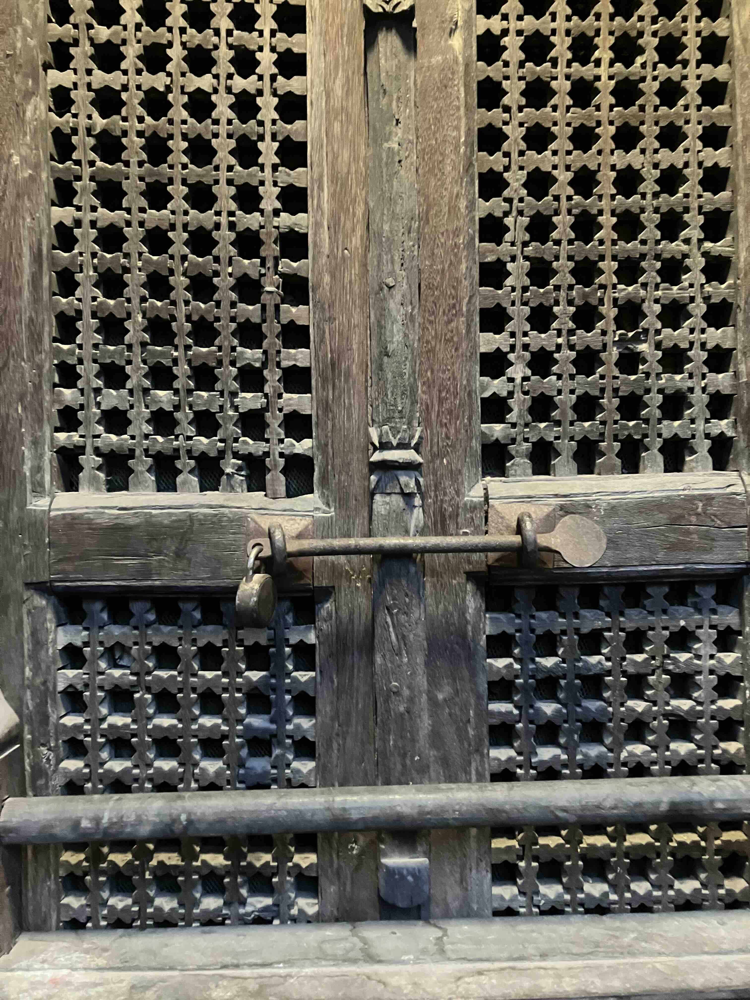
      (4.b)
    

  

  
  <figcaption style="text-align: center; font-style: italic; margin-top: 10px; color: #444;">
    Figure 4: An "arrow-like" binding object.
  </figcaption>
</figure>

The "arrowhead" part of the lock needs to be wide enough to not pass through the round latch. This "arrow" lock 
looks old enough that I wonder if it was originally meant to be used with something other than a padlock. 

---
Next up is this device that is somewhat in between of the "arrow" lock and the "coiled metal strand" lock. 
<figure style="margin: 20px 0;">
  

    
    

      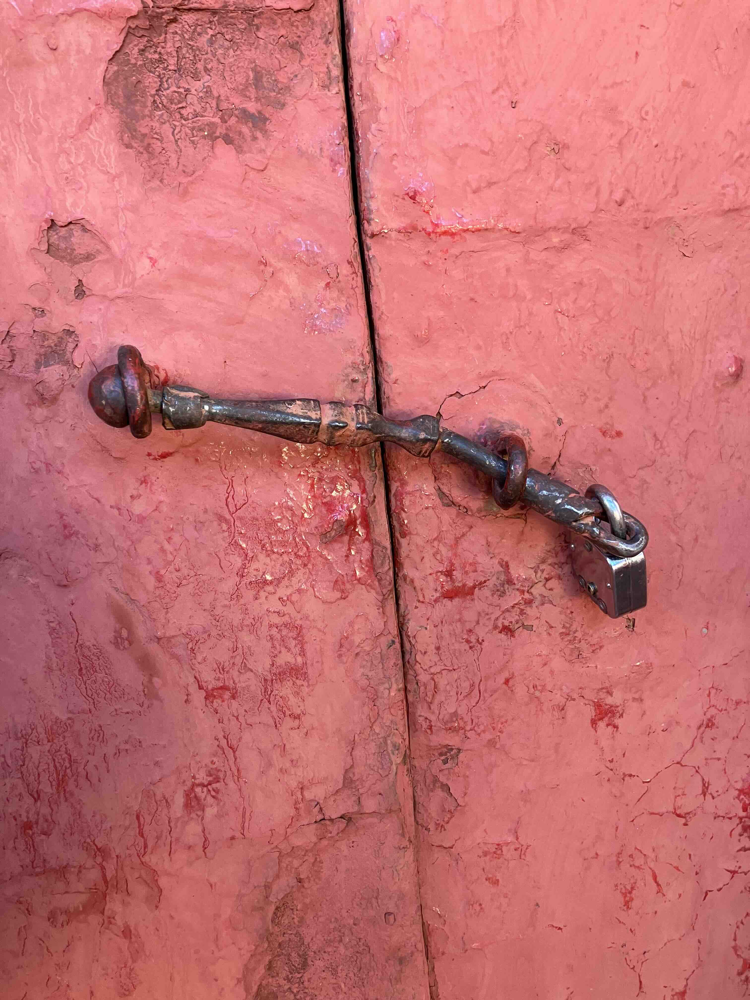
    

  

  
  <figcaption style="text-align: center; font-style: italic; margin-top: 10px; color: #444;">
    Figure 5: A mix between an "arrow" lock and a "coiled metal strand" lock. This one is on the western door of Chandannath temple in Jumla. 
  </figcaption>
</figure>

Again, I wonder if this lock was meant to be used with something other than a padlock. The left side of this lock is not quite
shaped like an arrow, like the ones in Figure 4, although it achieves the same purpose. Also, it is not clear from the picture, but the lock
isn't a single rod, the left and right part (or the "arrow" and the "coiled" part) are separate entities so it can be bent quite a bit. 
The reason why I think this might have used something other than a padlock (god! i would love to know what!) is that it looks quite old
and that it is on one of the most revered temples in the Karnali region (which makes me think it is quite old). One reason why it is different than the others we have seen so far could be that it is the only one from outside the Kathmandu Valley, and quite far at that (Jumla). 

---
<figure style="margin: 20px 0;">
  

    
    

      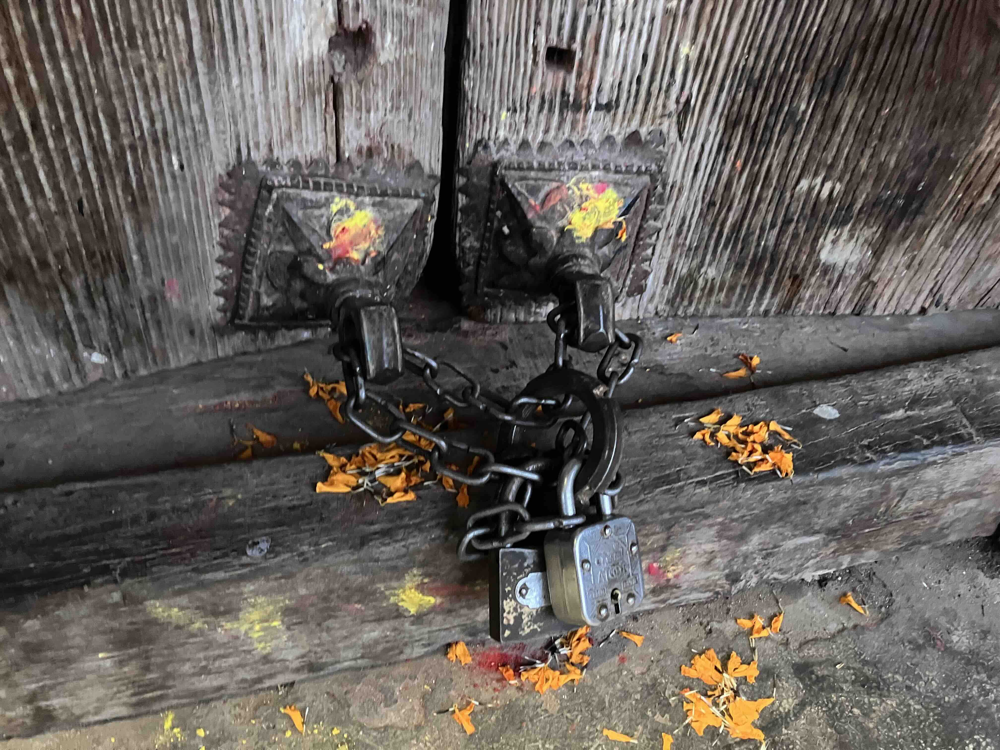
    

  

  
  <figcaption style="text-align: center; font-style: italic; margin-top: 10px; color: #444;">
    Figure 6: This one has the latches on the door but also has a large ring mounted on the wooden beam at the floor of the entrance. 
  </figcaption>
</figure>

This one, although similar to the ones below, gets a category of its own. The ring mounted on the beam is unique. I wonder if they originally 
used coiled metal strands where they have used the chain-links today. 

---
<figure style="margin: 20px 0;">
  

    
    

      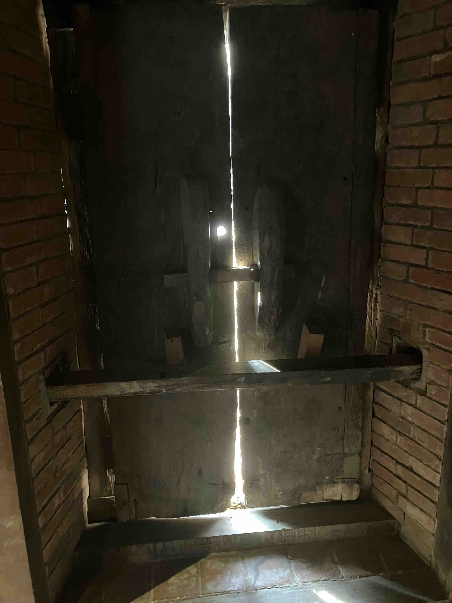
    

  

  
  <figcaption style="text-align: center; font-style: italic; margin-top: 10px; color: #444;">
    Figure 7: Keeping the door shut from the inside using wooden bars. 
  </figcaption>
</figure>

We now move on to one of the simplest door locking mechanisms - using a wooden beam to hold the door shut. This one, of course, only works
when you are trying to lock it from the inside. This particular picture is a good one, I think, because it shows two kinds of bars keeping 
the door in place. The shorter one goes through the door handles. I find the larger bar more interesting because it is supported by holes 
in the walls, which meant that this was a decision made when building the house in the first place. 
This picture was taken in the Patan Museum, I think.

---
<figure style="margin: 20px 0;">
  

    
    

      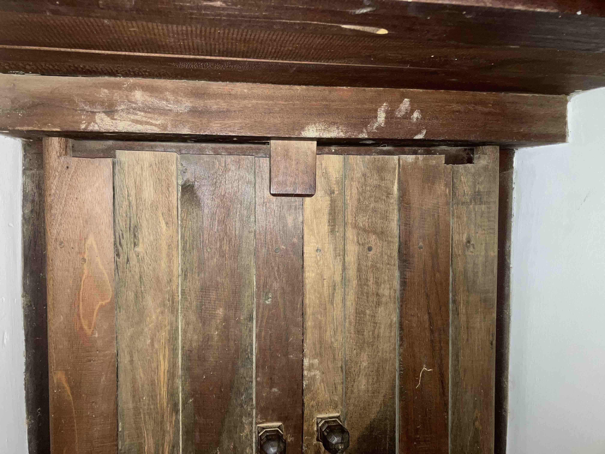
      (8.a)
    

    

      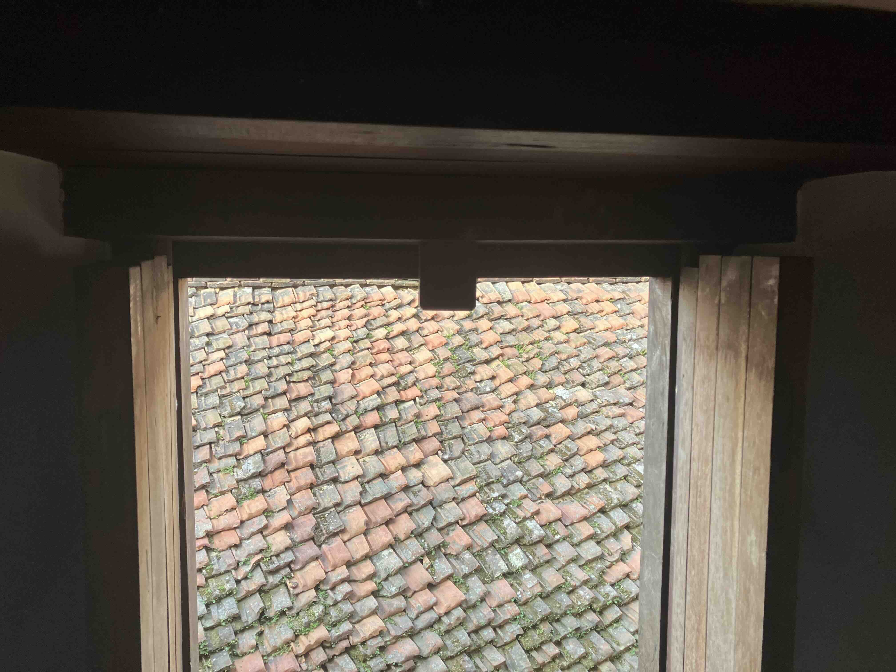
      (8.b)
    

  

  
  <figcaption style="text-align: center; font-style: italic; margin-top: 10px; color: #444;">
    Figure 8: A little slab of wood above the window to keep it shut.
  </figcaption>
</figure>

I love how simple this one is. This one was on a window in Patan Museum. (8.a) shows the window when shut, the slab of wood keeping the window from opening from the outside. To open the window (8.b) you push the wooden slab up, allowing you to swing the window doors open inward, and the little slab comes down to a rest again. One advantage of this little gravity-reliant mechanism is that you will never forget to lock the door - if the doors are fully shut the lock automatically locks them in place. 

A parallel technique is to build a little indent at the base of the door on the floor, and put a little wooden slab on it to close the door. I
did not take a picture of it, but the little gift shop in Patan Museum had such a dent that I felt must have been used for this. 

---
<figure style="margin: 20px 0;">
  

    
    

      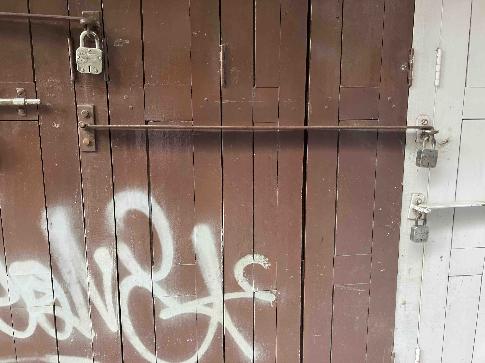
      (9.a)
    

    

      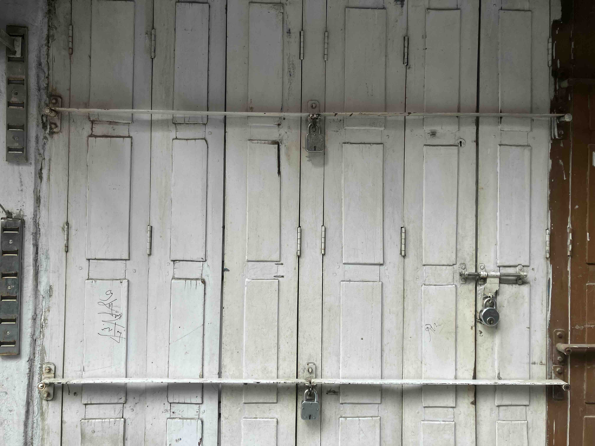
      (9.b)
    

  

  
  <figcaption style="text-align: center; font-style: italic; margin-top: 10px; color: #444;">
    Figure 9: A bar-based solution again, this time for locking from the outside.
  </figcaption>
</figure>

And finally, we have this bar-based approach, nowhere near as old as some of the other ones we've seen but still an 
ingenuos one. These pictures were from the shops near Kathmandu Durbar Square. I especially like (9.b)'s clever design
to use the same lock on two bars. 

---
*I expect this post to be a living document where I continually add new kinds of locking mechanisms I find. If you thought this 
was fun or have something to say then feel free to send me an email at bhushan_suwal@live.com!*

---
##### Footnotes:

[^1]: This is only one out of many wise ideas in this book, which advocates for an economic policy that is people-centric instead of production-centric. I would also highly recommend Helena Norberg-Hodge's book _Ancient Futures_, which is how I discovered Schumacher. 
